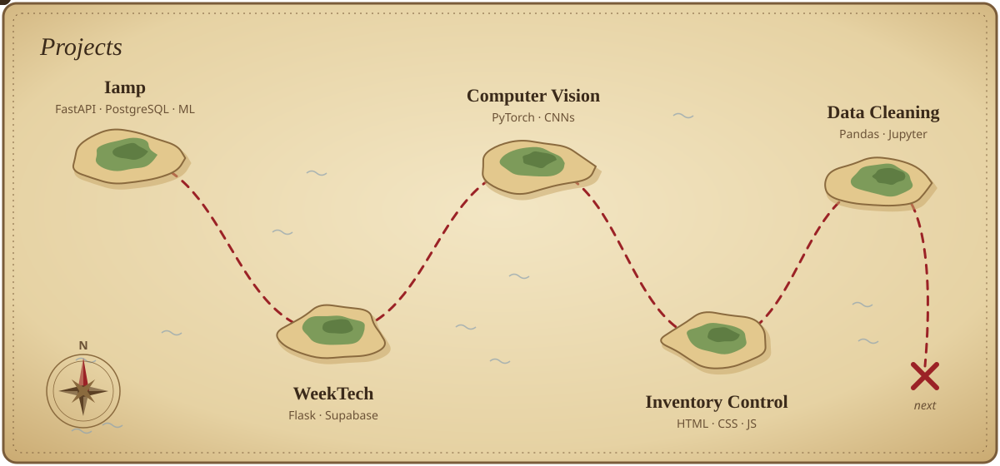

Software Development student at UniCesumar and part of the TCS AI bootcamp, based in Londrina, Brazil. I work across back-end, databases and data, and I'm currently bringing machine learning into the projects I build.

 

<b>Project details</b>

 

**[Iamp](https://github.com/BrunoStainski/ProjetoTCS-2026)** · how much each home appliance costs on your energy bill, using Inmetro and ANEEL data, with ML for models outside the database.

**WeekTech** · event website for UniCesumar's tech week. I owned the database integration, hosting and admin dashboard.

**Computer Vision** · image classifiers from scratch and with transfer learning (MobileNetV3, ResNet), plus facial expression recognition on the FANE dataset.

**Inventory Control** · full-stack web system for a nursing supply room, delivered across three sprints.

**Data Cleaning** · Inmetro appliance datasets cleaned and prepared to feed an application database.

 

